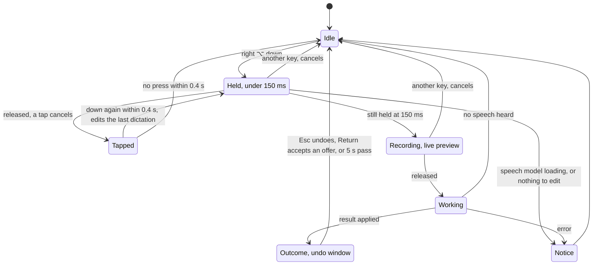
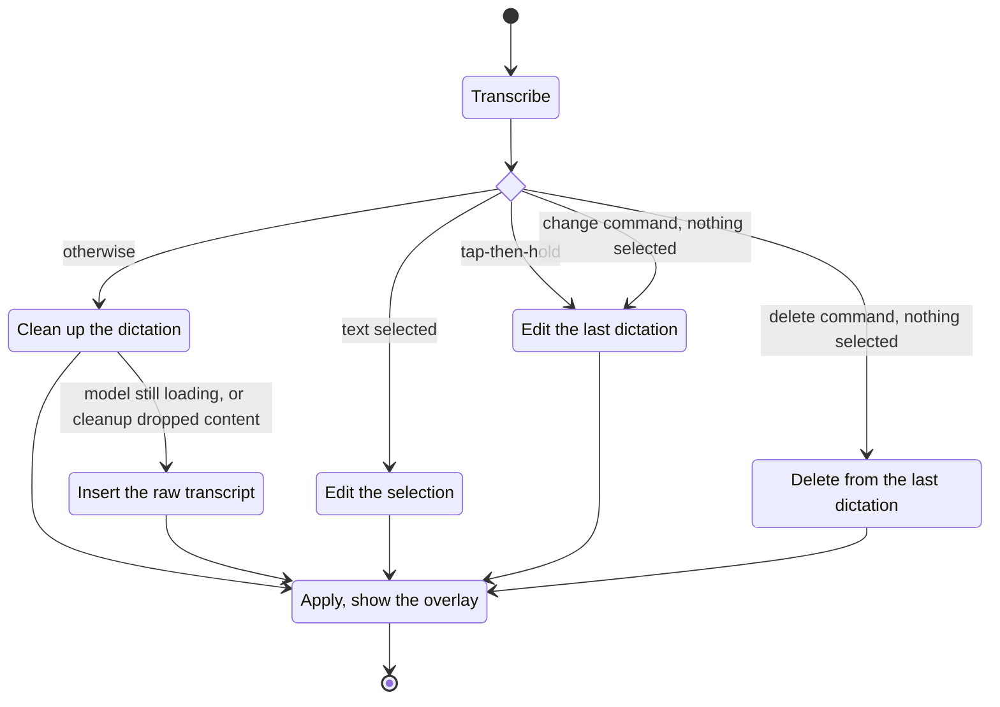
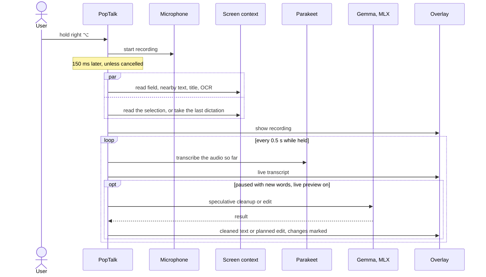
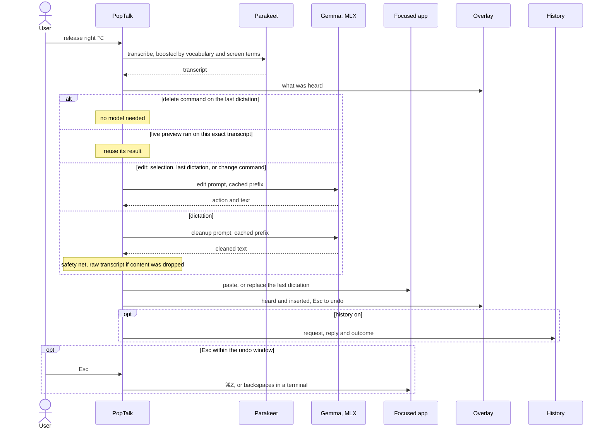

# PopTalk

Local voice dictation and voice editing for macOS. Hold **Right ⌥**, talk, let go.

- **Nothing selected:** PopTalk transcribes what you said, cleans it up (fillers, false starts, "Tuesday, no, Wednesday"), and types it at the cursor.
- **Text selected:** what you say is an instruction about the selection: "make this more formal", "turn this into bullet points", "translate to Japanese", or the case PopTalk was built for, fixing a misheard word: select "todo list" and say *"it's Todoist, capital T-O-D-O-I-S-T"*.

A small language model decides whether you're correcting, replacing, editing or inserting. Every result shows in a small overlay with **Esc to undo**.

Everything runs on your Mac. No audio, text or screen content leaves it, unless you turn on iCloud sync for the opt-in history.

## Using it

- **Hold and talk.** A tap under 150 ms, or pressing another key while ⌥ is down (⌥E and the like), cancels.
- **Live preview.** While you hold the key, the overlay shows the transcript and, at each pause, the cleaned-up text or the planned edit, with changed words marked. If you pause before letting go, release inserts that result without running the model again.
- **Overlay.** After a result, the overlay shows what was heard above what was inserted. **Esc** undoes it and **Return** accepts an offer, such as remembering a corrected word as vocabulary. Both keys work only while the overlay is up (the undo window, 5 s by default). The overlay moves above the field you're typing in if it would cover it. Drag it to move it; the position is remembered per display, and right-clicking it resets that display. A row of small icons shows anything inactive: a model still loading, a missing permission, a context source turned off, history recording on.
- **Voice commands on the last dictation.** With nothing selected, within a minute and while the field is as PopTalk left it: "scratch that", "delete the last word", "delete the last sentence", "no, I meant …", "change *A* to *B*".
- **Edit the last dictation.** Tap right ⌥, then press and hold it again within 0.4 s, and say an instruction ("make it more formal"). It applies to the last dictation as if you had selected it, under the same conditions as the voice commands.
- **Terminals.** In Ghostty, Terminal, iTerm2, kitty, WezTerm, Alacritty, Warp, Hyper and Tabby, undo and the commands above remove the dictated text with backspaces, since ⌘Z isn't a text undo there. They only work if you haven't typed since, and not for dictations containing a line break.
- **Spoken formatting.** "quote … unquote", "open paren … close paren", "new line" and "new paragraph" are applied in code. Spoken numbers become digits where unambiguous ("twenty five percent" → 25%, "three thirty pm" → 3:30 PM); zero to nine stay words in prose.
- **While models load.** If the language model isn't ready yet, dictation inserts the raw transcript, and the overlay offers **⏎ clean up now** once it is. Edits need the model: until it's ready they leave the selection unchanged.
- **Safety net.** If the cleanup drops content (sentences, quoted or bracketed text, line breaks), PopTalk inserts the raw transcript instead.

The hotkey, from press to the end of the undo window:



What a release does with what was said:



## How it works

1. **Speech:** [Parakeet TDT](https://huggingface.co/nvidia/parakeet-tdt-0.6b-v2) via [FluidAudio](https://github.com/FluidInference/FluidAudio) (v2 by default; other models in Settings), with CTC vocabulary boosting from your saved terms and from names visible on screen.
2. **Screen context:** the focused field, nearby text (Accessibility), the window title and the web domain, plus OCR around the field when an app hides its text. Password fields, password managers and private browser windows are never read. Each source can be turned off in Settings → Context.
3. **Language model:** Gemma 4 E2B running in-process with [MLX](https://github.com/ml-explore/mlx-swift-lm), with a LoRA fine-tune trained for PopTalk's two jobs (`adapters/gemma-4-e2b-poptalk-v3`, fused at load). Before cleanup, words that match a term on screen or in your vocabulary up to case are given its spelling ("meal prep" → "Meal Prep"). Gemma 4 E4B (base model, with its own tuned prompts) is an option for Macs with more memory. LM Studio and Apple's on-device model can be used instead.

On an M-series Mac, the time from releasing the key to inserted text is usually under a second. The fixed start of each prompt (instructions, screen context) is cached between requests, which cuts prompt processing time.

While the key is held, screen context and the selection are read alongside the recording, so they're ready at release:



At release:



With the default model, PopTalk uses about 1.5 GB of memory; with E4B, about 2.9 GB. PopTalk keeps a text-only copy of the Gemma model (without its vision and audio weights) and reads Gemma's per-layer embeddings from that file on disk rather than holding them in memory.

## Requirements

- An Apple Silicon Mac running macOS 14 or later. The Apple Intelligence provider needs macOS 26 or later; the Phonon-2 speech model needs macOS 15.
- A Swift 6 toolchain (Xcode or the command line tools) and Xcode's Metal toolchain for MLX: `xcodebuild -downloadComponent MetalToolchain`.
- A code-signing certificate, so macOS keeps the app's permissions between builds. A free Apple Development certificate works; `scripts/install.zsh` explains the one-time setup.

## Install

```sh
git clone https://github.com/thirteen37/Poptalk.git
cd Poptalk
scripts/install.zsh        # builds, signs, installs to /Applications and launches
```

On first launch, grant **Microphone**, **Accessibility** (to read and insert text) and **Screen Recording** (only for the OCR fallback). The menu-bar icon shows what's missing. Models download on first use: about 3.3 GB for the default language model, which PopTalk strips to a 2.5 GB text-only copy in `~/Library/Application Support/Poptalk/models` and then deletes the download. A model already in your Hugging Face cache is copied from there instead.

## Settings

- **General:** input device, undo window (2–15 s, default 5), live cleanup preview (on by default; it uses the GPU at each pause), reset overlay position, launch at login, version.
- **Context:** which context sources are read. Below that, opt-in local usage history, for training better models: off by default, audio optional, wiped with one button. History can also sync through iCloud Drive (`PopTalk/history`, audio excluded) to merge your Macs' history; turning it off offers to delete this Mac's synced copy, and the wipe can cover this Mac or all of them.
- **Models:** the speech model (Parakeet TDT v2, v3, Ultra, Bark 3.0 Clean, Phonon-2); the language-model provider (MLX, LM Studio, Apple) and the model for each role (cleanup and edit), including a custom Hugging Face id or local folder; "Fix screen-term casing before cleanup" (on; applies to the PopTalk fine-tunes); "Skip cleanup for clean dictations" (experimental, off: inserts a dictation with no fillers or corrections as heard, without the model); load status.
- **Permissions:** live status of each permission.
- **Vocabulary:** saved terms. PopTalk offers to remember a correction; it never saves one silently. Imports from FluidVoice.

## Development

```sh
swift build
swift test                                   # PoptalkCore and PoptalkMLX tests (Swift Testing)
swift build -c release && zsh training/bench.zsh adapters/gemma-4-e2b-poptalk-v3   # benchmark: dictation, edits, speech, held-out set
```

- `Sources/PoptalkCore`: prompts, pipeline, policies (pure, tested).
- `Sources/PoptalkSpeech`: ASR and boosting.
- `Sources/PoptalkMLX`: in-process models.
- `Sources/Poptalk`: the menu-bar app.
- `Sources/PoptalkBench`, `Sources/PoptalkDatagen`: the benchmark and training-data tools.
- `bench/`: benchmark cases and committed results. Compare runs with `PoptalkBench --compare a.json b.json`.
- `training/`: synthetic data generation and LoRA training (`mlx_lm.lora`, run with `uv`); see `training/make_data.zsh` and `training/lora.yaml`. `training/gepa_prompts.py` tunes prompts for models without a fine-tune.

Settings for A/B runs: `POPTALK_PLE_MMAP=0` keeps the per-layer embeddings in memory, `POPTALK_PROMPT_CACHE=0` turns off the prompt cache, and `POPTALK_SKIP_LLM=1` forces the skip-cleanup gate on (`0` off).

## License

MIT, see [LICENSE](LICENSE). The bundled fine-tune adapter is a Gemma 4 derivative under Apache 2.0, see [adapters/gemma-4-e2b-poptalk-v3](adapters/gemma-4-e2b-poptalk-v3/README.md). Speech models are downloaded at runtime under their own licenses.
