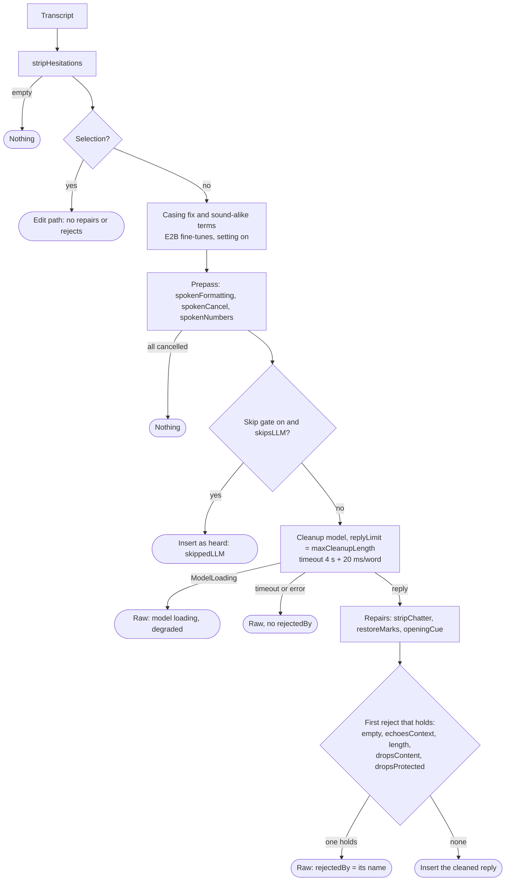

# Dictation guards

A dictation goes through the cleanup model, and the model can get it wrong: it can answer instead of cleaning, keep only the last sentence, drop a quote, or copy the screen. The guards are the string code around the model that fixes or catches those replies. This page covers what each one does, the order they run in, and what they cost and buy on the default model. The rest of the pipeline is in [How PopTalk works](how-it-works.md).

The guards are in `Sources/PoptalkCore/Pipeline.swift` (#108).

## Architecture

Pipeline keeps three named, ordered lists. Each step has a name, so the bench and the replay can turn it off and report which one fired.

- **`Pipeline.prepass`** rewrites the transcript before the model sees it. Its output is also what a raw fallback inserts, so spoken formatting survives a rejected reply.
- **`Pipeline.repairs`** rewrite the model's reply. Every repair runs, in order, on every reply.
- **`Pipeline.rejects`** test the repaired reply. The first one that holds turns the dictation into a raw fallback: the pre-passed transcript is inserted instead (label "Dictated (raw)"), and `PipelineResult.rejectedBy` is that reject's name. The ones after it don't run.

`Pipeline.guardNames` is the three lists in order. `PipelineResult.repaired` names the repairs that changed a reply beyond surrounding whitespace (#117), for the replay's counts.

### Prepass

| Step | Catches | Does | From |
| --- | --- | --- | --- |
| `spokenFormatting` | "quote … unquote", "open paren … close paren", "new line", "new paragraph" | Writes “…”, (…), `\n` and `\n\n` in code. A lone "quote", "quote and unquote", or a "new line" that isn't its own punctuated unit ("draw a new line") stay words. | #48 |
| `spokenCancel` | "scratch that" / "delete that" as its own unit | Drops the sentence before it and the command. With no sentence before it in this dictation, it stays literal. If everything is cancelled, nothing is inserted. | #98 |
| `spokenNumbers` | Number words | Writes digits where they're unambiguous: "twenty five percent" → 25%, "three thirty pm" → 3:30 PM, "one hundred and five" → 105. Zero to nine stay words in prose. | #59 |

### Repairs

| Step | Catches | Does | From |
| --- | --- | --- | --- |
| `stripChatter` | `<think>…</think>` blocks, echoed `<transcript>` tags, and `&amp;`, `&lt;`, `&gt;`, `&quot;` copied from the escaped prompt ("R&amp;D") | Removes the blocks and tags, trims the reply, and unescapes the entities, `&amp;` last so "&amp;lt;" stays "&lt;" (#145). | chatter guard, 42dfd60 (no issue); #145 |
| `restoreMarks` | Marks the prepass made that the model changed or added | Curly quotes the model straightened go back, with a `,` or `.` it moved inside put back outside. A line break the model flattened goes back between the same two words, if the reply has them next to each other. A list marker the model put on a lone item goes, unless the transcript is a list. | #75, #77 |
| `openingCue` | An opening "no", "sorry", "wait" or "actually" the model dropped (E2B v6 reads it as a self-correction with nothing before it) | Puts the cue back as "No, " and lowercases the next word, unless that word is "I", an acronym or a name. Not after a spoken cancel (the `dropsContent` cues). | #105 |

### Rejects

| Step | Holds when | From |
| --- | --- | --- |
| `empty` | Nothing is left after the repairs. | the first pipeline, abf4563 (no issue) |
| `echoesContext` | At least 3 of the reply's words, and more than half of them, weren't said but are on the screen: the model copied `<screen>`. | #29; before `length` since #116 |
| `length` | The reply is longer than `maxCleanupLength`: 1.5 × the transcript's characters + 40. A reply that long is the model answering, not cleaning. | chatter guard, 42dfd60 (no issue); early stop #100 |
| `dropsContent` | The reply lost more than 3 content words and more than 40% of them: the model kept only part of the dictation. After a spoken cancel ("scratch that", "never mind", "forget that"), only the words after the last cue count. "Forget that/it/the" is a cue only as its own unit: at the start, after a mark, or after "actually", "wait" or "no" ("Actually, forget the umbrella"); "I always forget the door code" is dictation (#148). | #47, #102, #148 |
| `dropsProtected` | A ( … ), “ … ” or " … " span from the transcript isn't in the reply in order, or the reply has fewer line breaks than the transcript. | #61 |

The order matters for the `rejectedBy` count, not for what is inserted: any reject means a raw fallback. `echoesContext` runs before `length` (#116), so a long screen echo is counted as an echo. Before #116 it ran last, and most real `length` hits were screen echoes over long terminal screens. It now also runs before `dropsContent` and `dropsProtected`, so an echo that also drops content is counted as an echo. No reject assumes an earlier one passed. The `replyLimit` early stop still cuts a long reply at the limit, and the cut reply is still counted as an echo when most of its words are screen words that weren't said. The move costs `echoesContext` (0.25 ms or less, see What they cost) only on replies `length` used to stop first; every used reply ran it already.

### Other mechanisms

- **`ReplyCheck`.** What a reject sees besides the reply and the transcript: the `maxCleanupLength` limit, and the screen (window title and domain, then the trimmed screen text). It is the whole trimmed screen, also for a short dictation whose prompt left the screen text out (below). It also carries the cleanup level the model was sent (#96): Clean unless the model was trained for levels. No guard reads it yet. Polished fixes grammar, so `dropsContent` and the fidelity checks will need to allow for that rewording once a level-trained model is benched.
- **Short dictations get no screen text (#116).** A dictation of at most `Pipeline.shortDictationWords` (5) words after the prepass gets an empty `<screen>` in its prompt (`Pipeline.cleanupContext`): the app, window title, domain and `<vocabulary>` stay, the screen text doesn't. Over long terminal screens, E2B v6 copied the screen instead of cleaning so short a dictation. Only the prompt changes: the casing fix, boost terms, learned terms and `echoesContext` still use the whole screen. The tag structure the fine-tune was trained on is unchanged, since a dictation with no screen context already gets an empty `<screen>`. Edits keep the screen. `PoptalkDatagen render` builds training prompts with the same `Pipeline.dictationMessages`, so fine-tune data for short dictations has no screen text either (#124).

  Picked on the replay (492 dictations, 157 of them 5 words or fewer, E2B v6), counts only. Each candidate against main, which had 3 raw fallbacks (2 `echoesContext` at 4 and 8 words, 1 `dropsContent`):

  | Candidate | Raw (echo) | Differ, ≤ N / > N | p50 / p90, ≤ N |
  | --- | --- | --- | --- |
  | main | 3 (2) | | 0.18–0.22 s / 0.23–0.29 s |
  | No screen text, N = 3 | 3 (2) | 6 / 0 | 0.13 / 0.17 s |
  | **No screen text, N = 5** | **2 (1)** | **20 / 4** | **0.12 / 0.15 s** |
  | No screen text, N = 6 | 2 (1) | 25 / 5 | 0.14 / 0.18 s |
  | No screen text, N = 8 | 1 (0) | 34 / 7 | 0.15 / 0.19 s |
  | 500 characters nearest the cursor, N = 5 | 2 (1) | 19 / 4 | 0.18 / 0.22 s |
  | 1,000 characters nearest the cursor, N = 5 | 4 (3) | 17 / 4 | 0.21 / 0.29 s |
  | 500 characters nearest the cursor, N = 8 | 1 (0) | 30 / 5 | 0.20 / 0.25 s |
  | Top 20 screen terms instead of the text, N = 5 | 3 (1) | 20 / 4 | 0.17 / 0.21 s |

  N = 8 removes both echoes but regresses the bench: with no screen text `d-long-ocr-thread`, `d-long-emoji-utf16` and `h-d-names-7` go from 3/3 to 0/3, and with 500 characters `d-long-emoji-utf16` and `h-d-names-7` do. They are 7- and 8-word dictations that need a name from the screen. No bench case with screen text has 6 words or fewer, so N = 5 leaves the bench unchanged (`d`, `e`, `s`, `h`, guards on and model only: identical outputs to main, [`bench/results/shortscreen-116/`](../bench/results/shortscreen-116/)). A nearby window echoed more as it grew, and a term list added a `dropsContent` fallback. The differing outputs over N have the same prompt as on main; they most likely come from the prompt cache, since the dictation before them had a different prompt. Two main runs back to back are identical. Latency is noisy between runs (main's p50 ranged 0.24–0.30 s across runs), but the short dictations' prompts are shorter.
- **`maxCleanupLength` and `replyLimit` (#100).** During a dictation cleanup, `Pipeline.replyLimit` (a task-local) holds `maxCleanupLength`. The MLX and LM Studio providers check `pastReplyLimit` as the reply streams and stop generating once the reply is certainly past the limit, with a 20-character margin for what the repairs can still remove. That reply would be rejected by `length` anyway, so stopping early only saves time. An open `<think>` never stops, since it may still be stripped. Edits have no limit: they can legitimately grow. Nor does a cleanup with `length` off (#118), so a `-length` or model-only run scores the whole reply.
- **Skip gate (`skipsLLM`, #75, experimental, off).** A dictation with no filler or correction cue, no spoken command left after the prepass, Parakeet's sentence casing and closing punctuation, at most 40 words, and no near-miss of a term goes in as heard, without the model (label "Dictated", `skippedLLM`). Setting: "Skip cleanup for clean dictations"; `POPTALK_SKIP_LLM=1` forces it on. The checks run in that order, cheapest first, and `skipGateStop` names the first that keeps the model: `casing`, `punctuation`, `cue`, `command`, `length`, `term`. The 40-word cap (#120) bounds the term shortlist, the only costly check. On real history every dictation over 40 words had already stopped at a cue (#122). The shortlist skips pairs of a run and a term that can't reach 0.75 by length alone, and computes each term's strings once per call. Its output is unchanged (see What they cost).
- **Fidelity probe (`fidelityProbe`, #75 step 2, experimental, off).** After the deterministic rejects, the loaded cleanup model is asked whether the repaired reply is a faithful cleanup of the pre-passed transcript at the press's level (`Pipeline.fidelityCheck`: a system message listing what a cleanup must not do, then the level's allowance, `<said>` and `<cleaned>`). One prefill, no generation: the score is log P(yes) − log P(no) at the first reply token (`MLXProvider.yesNoScore`, shared with the sound-alike term check). The system message and level text (~100 tokens) come from a prompt-prefix cache (#42): its own per load, so the probe's prompts never crowd the dictation's, storing a head of 64+ tokens once a second check repeats it. Below `Pipeline.fidelityProbeThreshold` (+2.0) the reply goes in raw, `rejectedBy` "fidelityProbe". A deterministic reject keeps its name, and a failed score keeps the reply. UserDefaults key `fidelityProbe`, no Settings UI; MLX only. `PoptalkBench --replay --fidelity shadow` (`scripts/replay.zsh --fidelity shadow`) scores every reply without acting and counts the overlap; `--fidelity-pairs` scores the invented pairs below.

  Picked on invented pairs (`training/fidelity_pairs.jsonl`, 86 pairs to fit, `fidelity_pairs_heldout.jsonl`, 77 held out, no shared transcripts, 0 hits against the v7 training items): each pair scored at verbatim, clean and polished, labelled by level (a grammar rewrite is fine only at polished, a reply that drops fillers is wrong at verbatim, a dropped clause or a wrong number is wrong at every level). `training/fidelity_probe.py` tried five phrasings on base E2B and on the v7 LoRA; the instruction-as-system-message one scored best (held-out AUC 0.936 on v7, 0.949 on base). The threshold rejects at most 5% of the fit split's acceptable rows. Held-out, all three levels (231 rows, 161 that should be rejected), v7 LoRA, Swift scores:

  | Rejects | Precision | Recall | Answers | Echoes | Invented | Wrong numbers | Kept a correction | Dropped parts | Reworded below polished | False rejects |
  | --- | --- | --- | --- | --- | --- | --- | --- | --- | --- | --- |
  | Deterministic (`Pipeline.rejects`) | 1.00 | 0.22 | 15/39 | 9/9 | 0/18 | 0/30 | 0/15 | 12/33 | 0/12 | 0/70 |
  | Probe | 1.00 | 0.58 | 30/39 | 9/9 | 17/18 | 26/30 | 7/15 | 1/33 | 3/12 | 0/70 |
  | Either | 1.00 | 0.68 | 34/39 | 9/9 | 17/18 | 26/30 | 7/15 | 12/33 | 3/12 | 0/70 |

  Per level the probe's recall is 0.63 verbatim, 0.57 clean, 0.54 polished. It catches what the thresholds can't see (a changed number or day, an added clause, a reply that answers in the dictation's own words) and misses most dropped clauses, which `dropsContent` catches only when the drop is large. On the fit split it rejected 3 of 78 acceptable rows (1 clean, 2 polished).

  On real history, `scripts/replay.zsh --fidelity shadow current` (520 dictations, E2B v7, all at Clean, two runs with identical counts): the probe would reject 2 replies (0.4%), neither of which a deterministic reject holds for. The one deterministic reject (`dropsContent`) the probe accepts. Of the 2, neither only changes casing or punctuation, and one adds a word that wasn't said; counts only, so whether they are real failures is unchecked. The probe takes 100–114 ms per reply at p50 and 129–134 ms at p90, on top of the cleanup: a whole dictation took 0.38–0.41 s p50 and 0.57–0.62 s p90 with it (no probe-off run back to back). With the cached head it takes 50 ms p50 and 72 ms p90, and a whole dictation 0.32 s p50 and 0.55 s p90 (one run, the same 2 probe rejects and 1 `dropsContent` reject it accepts). `scripts/fidelity-review.zsh` writes those replies, with transcript, score and guard, to `history/fidelity-review.md` for the owner (`scripts/test-fidelity-review.zsh` checks it on invented history).

  The cache moves scores a little (`--fidelity-pairs`, v7: up to 1.0, mean 0.17), because the head and the rest are prefilled in two passes. Splitting the same uncached pass in two moves them as much (up to 0.75), while a rerun of one path moves them by 2e-6. It made pairs scoring 2.2× faster, p50 140 → 63 ms (fit) and 126 → 60 ms (held out). At +2.0 the fit split's P/R is unchanged (0.963/0.572). Held out, precision stays 1.00 and recall goes 0.584 → 0.571; the table above is from before the cache.

- **Timeout (#3).** The cleanup has 4 s plus 20 ms per word. A timeout, or any other provider error, inserts the pre-passed transcript as a raw fallback with no `rejectedBy`.
- **Model loading (#31, #39).** If the model isn't loaded yet, the provider throws `ModelLoading` and the pre-passed transcript goes in labelled "Dictated (raw) · model loading". The result is `degraded`, so the overlay offers **clean up now** once the model is ready, and live preview doesn't reuse it.
- **Before the prepass.** `stripHesitations` drops um, uh, er, erm and hmm on every path; an empty result inserts nothing. Then, for E2B fine-tunes with "Fix screen-term casing before cleanup" on, the casing fix (`recaseTerms`, #75, #71) gives words that match a saved, learned or screen term up to case its spelling, and the experimental sound-alike check (`soundAlikeTerms`, off) can write a term the model confirms. Both are in [Matching names and terms](how-it-works.md#matching-names-and-terms).

### Turning guards off

`DictationFeatures.guardsOff` is a set of step names that `Pipeline.run` skips. The app never sets it; only `PoptalkBench --guards` does:

```sh
.build/release/PoptalkBench --provider mlx --cleanup-model adapters/gemma-4-e2b-poptalk-v7 --filter 'd-*' --guards -length
```

`--guards` takes a comma-separated list of `-name`, where a name is any of `Pipeline.guardNames` or a whole list: `-prepass`, `-repairs`, `-rejects`. It works in bench mode and in `--replay` (`scripts/replay.zsh --guards`). Result files get a `-guards` suffix, or `-model` when every repair and reject is off. `training/bench.zsh` runs the model-only pass with `--guards -repairs,-rejects`; it keeps the prepass, which shapes what the model is asked.

Turning `length` off also turns off the `replyLimit` early stop (#118), so a `-length` or model-only run scores the whole reply. Before #118 it scored a reply cut at the limit; on the bench that changed nothing, since no reply there reaches the limit (`d`, `e`, `h`, `s`, guards on and model only: identical outputs before and after, [`bench/results/replylimit-118/`](../bench/results/replylimit-118/)).

### Edits

Edits (a selection, or tap-then-hold on the last insert) don't go through the repairs or the rejects. They have their own checks in `Pipeline.run`: "literally", a trailing spelling and "replace this with" are handled in code; the model's reply must parse as an edit, and its text is unescaped as in `stripChatter` (#145); an insert the instruction didn't ask for becomes a replace; a blank replacement does nothing; and an insert that repeats the selection has it removed. A failed or timed-out edit leaves the selection unchanged and says so.

## Sequence

From the transcript Parakeet returns to the text that goes in, for a dictation (no selection):



1. `stripHesitations`. If nothing is left: **nothing** is inserted.
2. With a selection, the edit path runs instead; the rest of this list is dictation only.
3. The casing fix and, if on, sound-alike terms.
4. The prepass, in order: `spokenFormatting`, `spokenCancel`, `spokenNumbers`. If everything was cancelled: **nothing**.
5. The skip gate, if on. If `skipsLLM` holds: the pre-passed transcript goes in, **skipped LLM**.
6. The cleanup model, with `replyLimit` set and the timeout. A dictation of 5 words or fewer gets no screen text in its prompt (#116). Model still loading: **raw, model loading** (degraded). Timeout or error: **raw on timeout**.
7. The repairs, in order: `stripChatter`, `restoreMarks`, `openingCue`.
8. The rejects, in order: `empty`, `echoesContext`, `length`, `dropsContent`, `dropsProtected`. The first that holds: **raw on reject**, with `rejectedBy`.
9. Otherwise: the **cleaned** reply goes in.

Every insert gets a leading space when the cursor follows a non-space that isn't an opening bracket or quote. A raw fallback always inserts the transcript after step 4, so spoken formatting, cancels and numbers survive it.

## Performance

Measured 2026-11-26 on main d545fb6 (with #117's counts-only `repaired` field, which doesn't change what is inserted), with the default model: the E2B v6 LoRA `adapters/gemma-4-e2b-poptalk-v6` on base Gemma 4 E2B, MLX, an M-series Mac (Mac17,9). The numbers go stale when the model, the prompts, the guards or the bench cases change. Results: [`bench/results/guards-117/`](../bench/results/guards-117/).

### What the guards buy on the bench

`training/bench.zsh` runs each set with the guards on (the ship gate) and again model only (`--guards -repairs,-rejects`). Runs passed, of 3 runs per case:

| Set | Guards on | Model only | Change |
| --- | --- | --- | --- |
| d-* dictation (74 cases) | 204/222 | 198/222 | +6 |
| h-* held-out (88 cases) | 258/264 | 255/264 | +3 |
| e-* edits (18 cases) | 51/54 | 51/54 | 0 (edits don't use the guards) |

The +9 come from 3 cases: `d-fmt-new-line`, `d-fmt-new-paragraph` (0/3 → 3/3) and `h-d-keep-1` (0/3 → 3/3). With the guards on, the only reject that fired was `dropsContent`: 9 d runs and 1 of 50 s-* speech runs.

Then each repair and each reject turned off on its own (`--guards -name`, d-* and h-* with 3 runs), against the guards-on runs above:

| Step off | d runs | h runs | Cases that change |
| --- | --- | --- | --- |
| `stripChatter` | 204 (0) | 258 (0) | none |
| `restoreMarks` | 198 (−6) | 258 (0) | `d-fmt-new-line`, `d-fmt-new-paragraph` 3/3 → 0/3: the model flattens the spoken line break, and without the repair `dropsProtected` rejects the reply |
| `openingCue` | 204 (0) | 255 (−3) | `h-d-keep-1` 3/3 → 0/3: the reply loses the opening "No" |
| `empty` | 204 (0) | 258 (0) | none |
| `length` | 204 (0) | 258 (0) | none |
| `dropsContent` | 204 (0) | 258 (0) | outputs change, pass counts don't: `d-xs-oh-sorry-day`, `d-xs-no-wait-number`, `d-cancel-never-mind` |
| `dropsProtected` | 204 (0) | 258 (0) | none |
| `echoesContext` | 204 (0) | 258 (0) | none |

On the bench, two repairs carry the whole gain. `dropsContent` catches a real failure in the three cases it changes (the cleanup drops a sentence, or keeps the cancelled part instead of what follows), but the raw transcript it falls back to fails those cases too, because it keeps the words the speaker corrected away. The other rejects never hold on the bench: v6 doesn't answer, think aloud or echo the screen on these cases. They guard against what the replay below sees.

### How often they fire on real use

`scripts/replay.zsh current current` on the same day: 492 history dictations, two passes back to back, identical outputs (`diff` 0). Counts only:

| Step | Fired | Of 492 |
| --- | --- | --- |
| `length` (reject) | 2 | 0.4% |
| `dropsContent` (reject) | 1 | 0.2% |
| `empty`, `dropsProtected`, `echoesContext` (rejects) | 0 | |
| `openingCue` (repair) | 4 | 0.8% |
| `stripChatter`, `restoreMarks` (repairs) | 0 | |
| Timeouts | 0 | |

A repair counts when it changed the reply beyond surrounding whitespace, whether or not the reply was then used (`PipelineResult.repaired`, the replay's `chatter`, `marks` and `cue` columns). So 3 of 492 real dictations went in raw, and the guards changed 4 more. #116 found that `length` hits are mostly screen echoes over long terminal screens, counted as `length` because it ran first; `echoesContext` runs before it now. Since the short-dictation rule (#116 step 2), replayed back to back with main: 2 raw fallbacks, not 3 (`echoesContext` 2 → 1, `dropsContent` 1 → 1), no new ones, `openingCue` 4 and no timeouts or stray markers either way; 24 outputs differ, 20 of them dictations of 5 words or fewer.

### What they cost

The prepass, repairs and rejects are string code. Per call, median of 200, PoptalkCore built with `-O`, on invented text (a 38-word, 204-character dictation and a 190-word, 1,020-character one; a 64-term list; a 40-line, 4,000-character screen). `Tests/PoptalkCoreTests/GuardTimingTests.swift` has the code: `POPTALK_GUARD_TIMING=1 swift test --filter guardTiming` runs it in debug, and these numbers come from the same body compiled with `swiftc -O -swift-version 6 -module-name PoptalkCore Sources/PoptalkCore/*.swift`. The casing fix was re-measured with #121.

| Step | 38 words | 190 words |
| --- | --- | --- |
| `stripHesitations` | 0.01–0.03 ms | 0.03 ms |
| Casing fix (`recaseTerms`) | 0.47 ms (19.9 ms before #121) | 0.78 ms (20.1 ms) |
| `spokenFormatting` | 0.23 ms | 0.42 ms |
| `spokenCancel` | 0.10 ms | 0.14 ms |
| `spokenNumbers` | 0.17 ms | 0.77 ms |
| `stripChatter` | < 0.01 ms | < 0.01 ms |
| `restoreMarks` | 0.04 ms | 0.19 ms |
| `openingCue` | < 0.01 ms | < 0.01 ms |
| `empty`, `length` | < 0.01 ms | < 0.01 ms |
| `dropsContent` | 0.05 ms | 0.25 ms |
| `dropsProtected` | 0.07 ms | 0.23 ms |
| `echoesContext` | 0.17 ms | 0.25 ms |
| Skip gate (`skipsLLM`, off), on a clean dictation of the same length (median of 9) | 4.8 ms (170 ms before #120) | 0.4 ms: over 40 words, stops at `length` (870 ms) |
| Its term shortlist alone (`termShortlist`), past the cap | 4.7 ms | 19.7 ms |

The prepass, repairs and rejects together take about 0.9 ms on the short dictation and 2.3 ms on the long one, against 0.31 s mean for the cleanup itself on the replay (p90 0.49 s). The casing fix runs by default with v6, once per dictation, so its cost isn't per word: it scales with the terms and the screen. It lowercases the transcript and the screen once (about 0.35 ms of it for this screen), then searches the transcript for each term, and the screen only for the terms the transcript has. Before #121 it compiled a regex per term and scanned the whole screen with each, about 20 ms whatever the length.

**The skip gate's cost.** The rows above are a synthetic worst case: a clean dictation, so no cue stops the gate before the term shortlist, against 64 invented terms that aren't dictionary words. The shortlist compares every run of 1–3 words with every term, by edit distance on the squashed strings, their consonant skeletons, and the sound-folded versions of both. Before #120 that took 170 ms at 38 words and 870 ms at 190, more than the cleanup it would skip. Two changes bound it:

- **Word cap.** Dictations over 40 words keep the model (`length`) before the shortlist runs.
- **Length prefilter.** A run and a term score `1 − edit distance / longer length`, the best of the four comparisons. The edit distance is at least the length difference, so a comparison scores at most shorter / longer and can reach 0.75 only if 4 × shorter ≥ 3 × longer. The shortlist checks that for all four comparisons first and computes edit distances only for those that pass. A skipped comparison can't be the best score of a run it keeps. Each term's squashed, folded and skeleton strings are computed once per call, not once per run. The bound has to cover the skeletons too: "abt" and "aaaabt" fail it on the raw strings but have the same skeleton. A first-letter check would not be safe, since the edit distance can change the first letter. `TermShortlistPrefilterTests` checks that the output, scores included, matches the old version's on invented near misses.

On real history (#122, 492 dictations, gate on) the gate fires on 61% of dictations and saves a median of about 235 ms of model time per skip (p90 about 360 ms). Its own time, replayed back to back before and after #120, drops from a median of 3.2 ms to 0.6 ms (p90 15.8 to 1.5 ms, max 79 to 3.7 ms). Both runs skip the same 298 dictations, with the same stops and identical outputs, and none stops at `length`. With the cap, the synthetic worst case is 4.8 ms at 38 words, and no longer dictation reaches the shortlist. The opt-in timing test fails if `skipsLLM` takes over 400 ms in debug (104 ms measured, about 20× the -O time).

The `replyLimit` early stop: on the 2 history dictations `length` rejects, the cleanup takes 0.84 s and 0.56 s with it (median of 3) and 2.32 s and 2.01 s with it patched out, about 1.5 s saved per hit. Without it the replies run on to 384 and 574 characters instead of being cut at 146 and 114, and are rejected either way. The bench has no `length` hits, so it doesn't show this, and the timing log (`log stream`, category `timing`, "stopped at reply limit") isn't kept by default. Since #119 the provider waits for the stopped generation to finish its step before it returns (a replay whose last dictation stopped early used to crash at exit).

### Known issues

- #116: dictations of 6 words or more over long screens can still echo the screen (1 of 492 on the replay, 8 words). They count as `echoesContext` and go in raw. A wider no-screen rule costs bench cases that need a name from the screen; a retrain with such cases is open (#123).
