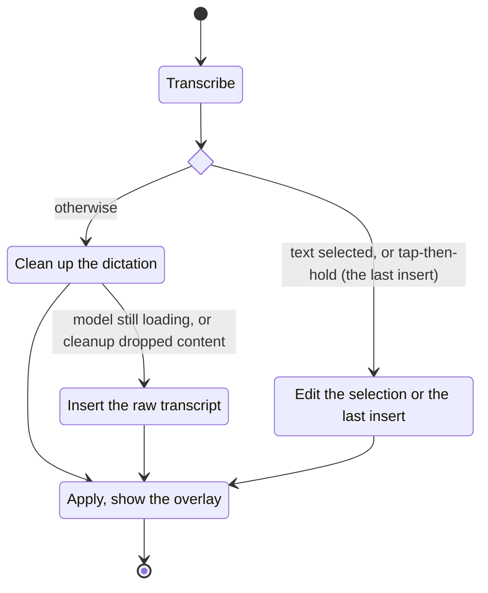
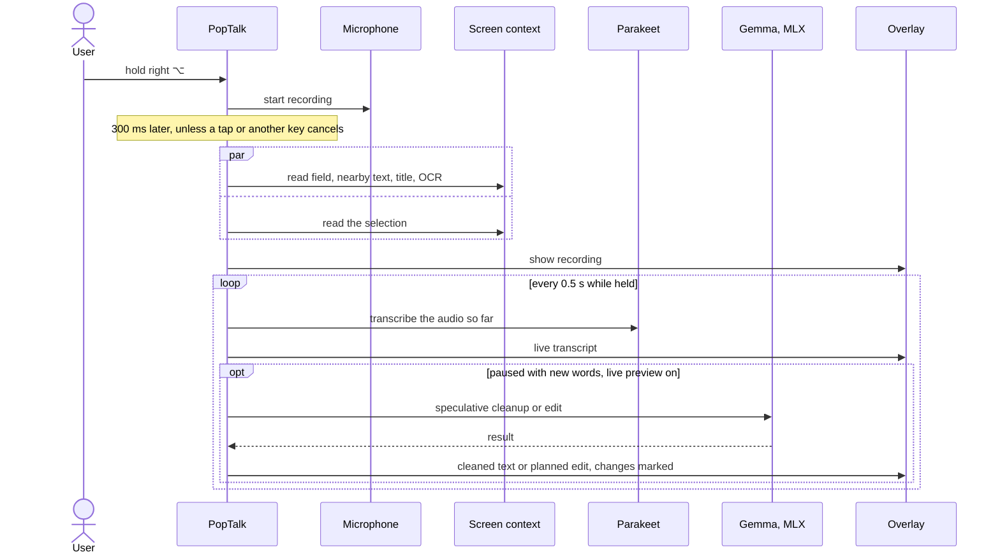
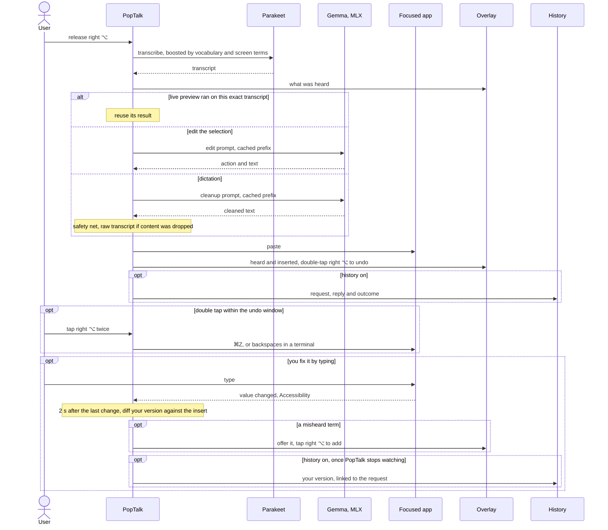

# How PopTalk works

The detailed reference: what each key does, how a dictation flows through the pipeline, memory use, and every setting. For an overview, installation and limits, see the [README](../README.md).

## Using it, in detail

| Right ⌥ | Does |
| --- | --- |
| Hold | Dictate, or edit the selection |
| Tap | Accept the showing offer, or cancel a recording |
| Double tap | Undo |
| Tap, then hold | Edit the last insert |

- **Hold and talk.** The times here are the defaults; "Longest tap" (150–500 ms) and "Double-tap speed" (250–800 ms) in General's advanced options change them, and a longer tap also delays the recording bubble. A tap under 300 ms, or pressing another key while ⌥ is down (⌥E and the like), cancels. A tap also accepts the offer showing in the overlay (below), 0.4 s later, once it can't be the start of a double tap; a second press in that time drops the accept. Two taps, the second pressed within 0.4 s of the first one's release, undo the showing result; the undo runs on the second release, so ⌥ is up before any backspaces go out. Hold that second press instead and it records an edit of the text PopTalk just inserted, run as if that text were selected (live preview included) and applied in place; undo puts the previous text back. It needs the insert untouched: its field focused with the same text and not a password field, or in a terminal nothing typed since. Otherwise the overlay says "Nothing to edit" and nothing is inserted.
- **Live preview.** While you hold the key, the overlay shows the transcript and, at each pause, the cleaned-up text or the planned edit, with changed words marked. If you pause before letting go, release inserts that result without running the model again.
- **Overlay.** After a result, the overlay shows what was heard above what was inserted. A **double tap of right ⌥** undoes it and a **tap** accepts an offer, such as remembering a corrected word as vocabulary. Both work only while the overlay is up (the undo window, 5 s by default); typing in the field closes it, so undo can't take back your typing and a tap can't accept an offer you've typed past. PopTalk catches no keys: Esc and Return always go to the app. The overlay moves above the field you're typing in if it would cover it. Drag it to move it; the position is remembered per display, and right-clicking it resets that display. A row of small icons shows anything inactive: a model still loading, a missing permission, a context source turned off, history recording on.
- **Fix it by typing.** Instead of dictating a correction, fix the dictated text in the field. About 2 s after you stop typing, PopTalk compares your version with what it inserted. If you replaced words speech recognition misheard with a name or term ("todo list" → Todoist), the overlay offers to add it to your vocabulary, with what was heard as an alias: tap **right ⌥** to add it, or ignore it. It stays up while you type. With history on, your version is recorded with the dictation. PopTalk stops watching when you leave the field, dictate again or undo, or after 3 minutes. Not in terminals or password fields, and only in apps whose text fields PopTalk can read.
- **Terminals.** In Ghostty, Terminal, iTerm2, kitty, WezTerm, Alacritty, Warp, Hyper and Tabby, apps built on Ghostty's library (such as Herdr), and any app that registers as a shell for Unix executables, undo removes the dictated text with backspaces, since ⌘Z isn't a text undo there. It only works if you haven't typed since, and not for dictations containing a line break.
- **Spoken formatting.** "quote … unquote", "open paren … close paren", "new line" and "new paragraph" are applied in code. Spoken numbers become digits where unambiguous ("twenty five percent" → 25%, "three thirty pm" → 3:30 PM); zero to nine stay words in prose.
- **While models load.** If the language model isn't ready yet, dictation inserts the raw transcript, and the overlay offers **clean up now** once it is: tap right ⌥. Edits need the model: until it's ready they leave the selection unchanged.
- **Safety net.** If the cleanup drops content (sentences, quoted or bracketed text, line breaks), PopTalk inserts the raw transcript instead.

The hotkey, from press to the end of the undo window:

```mermaid
stateDiagram-v2
    state "Idle" as Idle
    state "Held, under 300 ms" as Arming
    state "Recording, live preview" as Recording
    state "Working" as Working
    state "Outcome, undo window" as Outcome
    state "Notice" as Notice
    state "Typed-fix offer" as Offer

    [*] --> Idle
    Idle --> Arming: right ⌥ down
    Arming --> Idle: released, or another key, cancels; a lone tap accepts a showing offer 0.4 s later, a second tap within 0.4 s undoes a showing outcome
    Arming --> Recording: still held at 300 ms (right after a tap: an edit of the last insert)
    Arming --> Notice: right after a tap, still held, nothing to edit
    Arming --> Notice: speech model loading
    Recording --> Idle: another key, cancels
    Recording --> Working: released
    Working --> Idle: no speech heard
    Working --> Outcome: result applied
    Working --> Notice: error
    Notice --> Idle
    Outcome --> Arming: right ⌥ down (a tap or double tap leaves it up until it acts)
    Outcome --> Idle: undone, offer accepted, you type, or 5 s pass
    Idle --> Offer: you fixed a misheard term by typing, 2 s pause
    Offer --> Arming: right ⌥ down
    Offer --> Idle: 6 s pass
```

What a release does with what was said:

## Pipeline

1. **Speech:** [Parakeet TDT](https://huggingface.co/nvidia/parakeet-tdt-0.6b-v2) via [FluidAudio](https://github.com/FluidInference/FluidAudio) (v2 by default; other models in Settings), with CTC vocabulary boosting from your saved terms and from names visible on screen.
2. **Screen context:** the focused field, nearby text (Accessibility), the window title and the web domain, plus OCR around the field when an app hides its text. Password fields, password managers and private browser windows are never read. Each source can be turned off in Settings → Context, or per app or website in Settings → Apps: the most specific profile (app and website, then app, then website) turns sources off for that press, and a source off in Context stays off everywhere. The page's host is looked up to match a website profile, and reaches the prompt only if the profile allows the web domain. Opt-in, a screen term that changed a dictation (a boost wrote it, or the casing fix used its spelling) is remembered on this Mac and boosts and recases later dictations without the screen; unused for 30 days, it's dropped.
3. **Language model:** a PopTalk fine-tune of Gemma 4 E2B (a LoRA adapter, `adapters/gemma-4-e2b-poptalk-v6`, applied unfused on the base) running in-process with [MLX](https://github.com/ml-explore/mlx-swift-lm), for both of PopTalk's jobs; base Gemma 4 E4B with prompts tuned for it is an option in Settings. LM Studio and Apple's on-device model can be used instead; Apple's is the one for Macs with 8 GB of memory or less. A custom model id can also be a local LoRA adapter folder (as `training/` makes), applied on its base at load; for E2B fine-tunes, words that match a term on screen or in your vocabulary up to case are first given its spelling ("meal prep" → "Meal Prep").

### Matching names and terms

Several steps match what was heard against terms PopTalk knows. In order:

1. **Which terms.** Your saved vocabulary comes first, then learned screen terms (opt-in, below), then up to 60 terms pulled from the screen context the model sees (`Pipeline.boostTerms`, `TermExtractor`). Screen terms are proper nouns and capitalized phrases, camelCase, ALLCAPS, and identifiers with digits, `_` or `-`. They're ranked by closeness to the cursor, presence in the window title, and frequency. Each term also gets aliases for how it's likely heard (`Pipeline.boostAliases`): camelCase split, `-` `_` `.` as spaces, digits spelled out, lowercased ("FluidAudio" → "fluid audio", "gpt-4o" → "gpt four o"), plus a phrase's fused form ("Q3 OKRs" → "q3okrs"). A saved term's "heard as" forms are aliases too.
2. **Boosting, during recognition (FluidAudio).** Parakeet TDT transcribes first, with no knowledge of the terms. FluidAudio's `VocabularyBoostingSession` then runs a second, small CTC model (Parakeet CTC 110M) over the same audio, finds spans that look like a term or alias, scores how well the audio fits the term, and proposes replacements. Two thresholds control it: `minSimilarity` (0.7), how close the heard span must be to the term before it's considered, and `cbw` (1), the context-biasing weight, the extra credit a term gets when the audio is rescored (`Pipeline.boostCbw`, `boostMinSimilarity`). A term's `weight` isn't used by this rescorer. Both were tuned on the real-voice and synthetic speech benches (#99): cbw 1 roughly triples the words boosting fixes on real voice without breaking more, and from 1.5 up it replaces correctly heard words; `minSimilarity` below 0.7 broke words on real voice.
3. **Re-applying the boosts (PopTalk).** PopTalk keeps only the replacements FluidAudio marks as replace and applies them to the original transcript itself (`Pipeline.applyBoosts`), because FluidAudio's own rewrite over-applied (#70: it swapped "Pop Talk build" and "3.30pm" for "PopTalk"). Each term goes only onto the run of words in its span most like the term or an alias, if that reaches the same `minSimilarity` and adds no digits the term lacks; the span's other words stay. The run may take in a neighbouring word that completes the term (the rescorer can propose "fluid" alone for FluidAudio, which would leave "FluidAudio audio"). Then `splitFused` respaces phrase terms heard as one word ("Q3OKRs" → "Q3 OKRs").
4. **Casing fix, before cleanup (E2B fine-tunes only).** Words that equal a term up to case and spacing get its spelling (`Pipeline.recaseTerms`: "meal prep" → "Meal Prep", "fluid audio" → "FluidAudio"). It holds back on whole words only; a term under 5 characters joins only pieces of 3+ characters or single letters ("d b t" → "DBT", not "an a" → "Ana"); single-word terms made of dictionary words ("Inbox") are skipped, a phrase mixing dictionary words and names gives only its names; and a term the screen shows in more than one spelling is skipped too. Setting: "Fix screen-term casing before cleanup". E4B fixes terms itself and did worse when they were pre-fixed.
5. **Sound-alike terms (experimental, off).** For words the steps above left alone that only sound like a term ("core vanta" for Korvanta), `Pipeline.termShortlist` finds runs of 1–3 words at least 0.75 similar to a term. It compares the raw spellings and sound-folded ones (ph→f, x→ks, qu→kw, q→k, z→s, soft c→s, other c→k) and skips runs overlapping a term already heard exactly. Each candidate then gets one yes/no question to the loaded model ("is this heard text the term?"); PopTalk reads how much likelier "yes" is than "no" without generating, about 12 ms a dictation after the shortlist. A score at or above −7.12, fitted for the v6 adapter, gives the term's spelling before cleanup. On invented held-out pairs: precision 0.96, recall 0.79 (#75). MLX and E2B fine-tunes only; turn it on in Settings → Models, "Match sound-alike terms (experimental)", shown with the casing fix on. The threshold needs refitting when the default adapter changes.
6. **Cleanup.** The language model sees the screen context and the terms in its prompt and fixes what's left, such as casing in context and names the steps above couldn't place. On real voice this recovers most of the term recall (#99).

`similarity` in these steps is 1 − edit distance / longer length, the better of the raw strings and their consonant skeletons (`Pipeline.similarity`).

Related matching elsewhere:
- **Learned screen terms** (opt-in, "Remember screen terms that fix dictations"): a screen term that changed a dictation, through a boost or the casing fix, is remembered on this Mac only. It boosts and recases later dictations without being on screen, up to 200 terms, dropped after 30 days unused (`LearnedTerms`).
- **Skip-cleanup gate** (experimental, off): a dictation goes in as heard only if it has no filler or correction cue, no spoken command, starts capitalized, ends with `.`, `!` or `?`, and the sound-alike shortlist finds no near-miss term in it (`Pipeline.skipsLLM`).
- **Typed fixes:** when you fix a dictation by typing, PopTalk diffs your version against the insert word by word (`TypedCorrection`). A replaced word that came from the transcript, where your word didn't, counts as misheard and becomes a vocabulary offer, with what was heard as its alias.
- **Re-dictation** (history only): a dictation into the same field within 30 s of the insert, or 120 s after it was deleted or undone, that is at least 0.6 similar to the last raw transcript is recorded as saying it again (`Redictation`).

On an M-series Mac, the time from releasing the key to inserted text is usually under a second. The fixed start of each prompt (instructions, screen context) is cached between requests, which cuts prompt processing time.

While the key is held, screen context and the selection are read alongside the recording, so they're ready at release:

At release:

## Memory

With the default model, PopTalk uses about 1.6 GB of memory (about 3 GB with Gemma 4 E4B). Apple's on-device model runs in macOS, outside PopTalk, so it suits Macs with 8 GB or less; Settings suggests it there. PopTalk keeps a text-only copy of the Gemma model (without its vision and audio weights) and reads Gemma's per-layer embeddings from that file on disk rather than holding them in memory.

## Settings

"Show advanced options" (General, off by default) reveals an Advanced section on General and Models with tuning details and experimental features. Hidden settings keep their values and still apply.

- **General:** input device, live cleanup preview (on by default; it uses the GPU at each pause), reset overlay position, launch at login, version. Advanced: the undo window (2–15 s, default 5), the longest tap (150–500 ms, default 300) and the double-tap speed (250–800 ms, default 400).
- **Context:** which context sources are read, and whether to remember screen terms that fix dictations (off by default; stored on this Mac only, never synced; turning it off offers to forget them). Below that, opt-in local usage history, for training better models: off by default, audio optional, wiped with one button. History can also sync through iCloud Drive (`PopTalk/history`, audio excluded) to merge your Macs' history; turning it off offers to delete this Mac's synced copy, and the wipe can cover this Mac or all of them.
- **Models:** the speech model (Parakeet TDT v2, v3, Ultra, Bark 3.0 Clean, Phonon-2); the language-model provider (MLX, LM Studio, Apple, with LM Studio's server and models); load status. Advanced: the MLX model for each role (cleanup and edit), including a custom Hugging Face id or local folder; "Fix screen-term casing before cleanup" (on; shown only for an E2B fine-tune adapter), and under it "Match sound-alike terms" (experimental, off); "Skip cleanup for clean dictations" (experimental, off: inserts a dictation with no fillers or corrections as heard, without the model).
- **Permissions:** live status of each permission.
- **Vocabulary:** saved terms. Add, edit (double-click or the pencil) or delete them, each with optional "heard as" forms the recognizer should map to it. PopTalk offers to remember a correction; it never saves one silently. Imports from FluidVoice. Below, "Learned from screen" lists remembered screen terms (up to 200, newest first): move one to your vocabulary, delete it, or forget all.

Settings for A/B runs: `POPTALK_PLE_MMAP=0` keeps the per-layer embeddings in memory, `POPTALK_PROMPT_CACHE=0` turns off the prompt cache, and `POPTALK_SKIP_LLM=1` forces the skip-cleanup gate on (`0` off). Speech-bench options for the matching steps: `--boost on|off`, `--cbw`, `--min-similarity`, `--recase-terms on|off`, `--sound-alike on`; real-voice runs are in [Real-voice speech bench](real-voice-bench.md).
