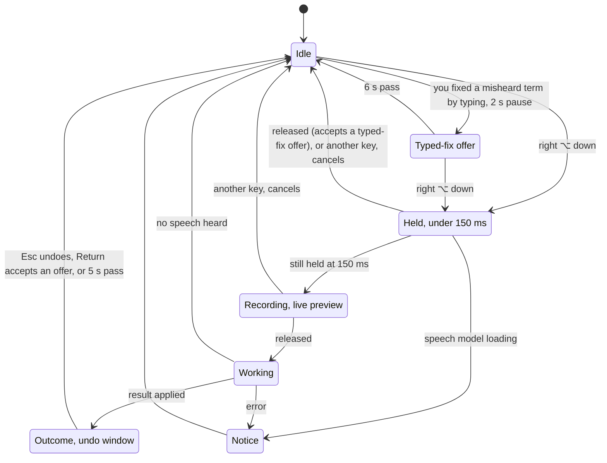
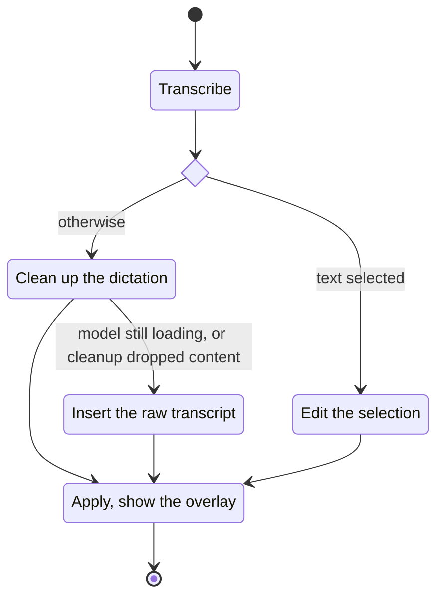
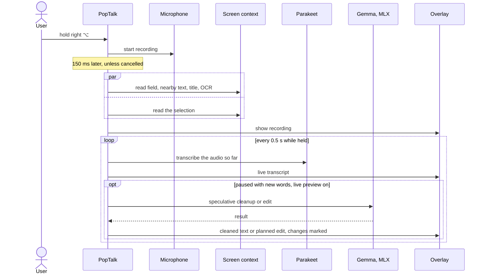
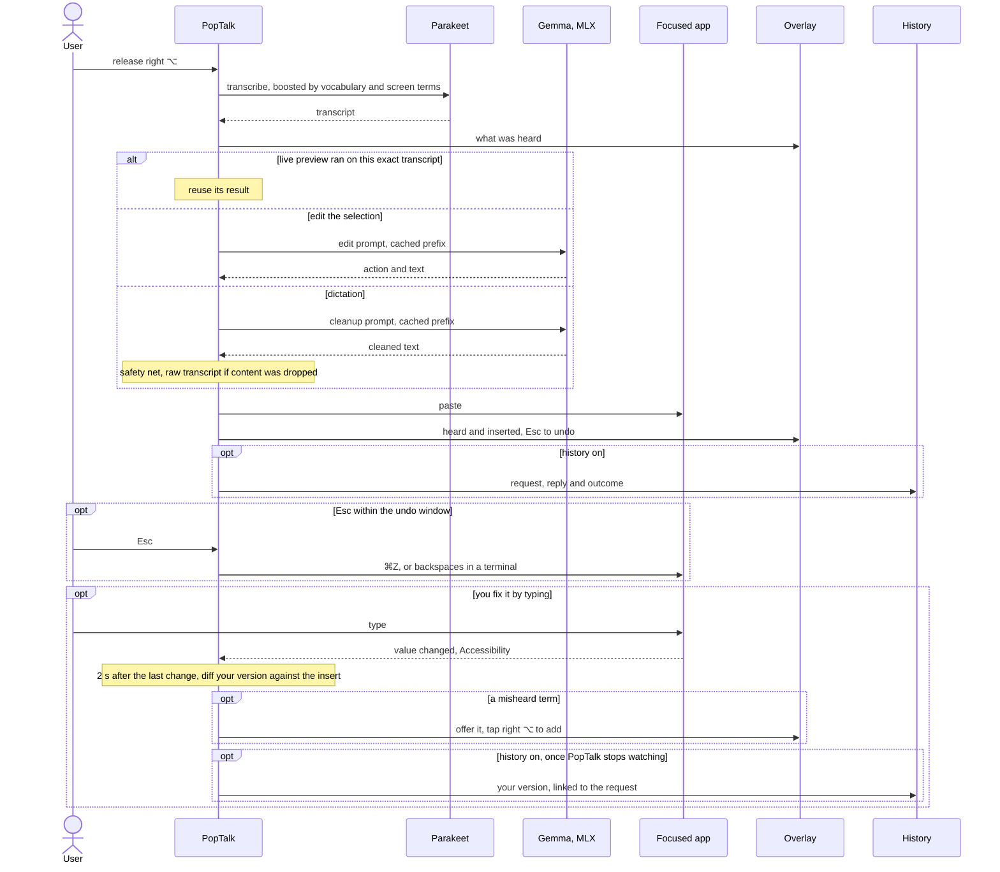

# How PopTalk works

The detailed reference: what each key does, how a dictation flows through the pipeline, memory use, and every setting. For an overview, installation and limits, see the [README](../README.md).

## Using it, in detail

- **Hold and talk.** A tap under 150 ms, or pressing another key while ⌥ is down (⌥E and the like), cancels. A tap also accepts a typed-fix offer (below).
- **Live preview.** While you hold the key, the overlay shows the transcript and, at each pause, the cleaned-up text or the planned edit, with changed words marked. If you pause before letting go, release inserts that result without running the model again.
- **Overlay.** After a result, the overlay shows what was heard above what was inserted. **Esc** undoes it and **Return** accepts an offer, such as remembering a corrected word as vocabulary. Both keys work only while the overlay is up (the undo window, 5 s by default); typing in the field closes it, so they reach your text. The overlay moves above the field you're typing in if it would cover it. Drag it to move it; the position is remembered per display, and right-clicking it resets that display. A row of small icons shows anything inactive: a model still loading, a missing permission, a context source turned off, history recording on.
- **Fix it by typing.** Instead of dictating a correction, fix the dictated text in the field. About 2 s after you stop typing, PopTalk compares your version with what it inserted. If you replaced words speech recognition misheard with a name or term ("todo list" → Todoist), the overlay offers to add it to your vocabulary, with what was heard as an alias: tap **right ⌥** to add it, or ignore it. The offer leaves Esc and Return to your field. With history on, your version is recorded with the dictation. PopTalk stops watching when you leave the field, dictate again or undo, or after 3 minutes. Not in terminals or password fields, and only in apps whose text fields PopTalk can read.
- **Terminals.** In Ghostty, Terminal, iTerm2, kitty, WezTerm, Alacritty, Warp, Hyper and Tabby, apps built on Ghostty's library (such as Herdr), and any app that registers as a shell for Unix executables, undo removes the dictated text with backspaces, since ⌘Z isn't a text undo there. It only works if you haven't typed since, and not for dictations containing a line break.
- **Spoken formatting.** "quote … unquote", "open paren … close paren", "new line" and "new paragraph" are applied in code. Spoken numbers become digits where unambiguous ("twenty five percent" → 25%, "three thirty pm" → 3:30 PM); zero to nine stay words in prose.
- **While models load.** If the language model isn't ready yet, dictation inserts the raw transcript, and the overlay offers **⏎ clean up now** once it is. Edits need the model: until it's ready they leave the selection unchanged.
- **Safety net.** If the cleanup drops content (sentences, quoted or bracketed text, line breaks), PopTalk inserts the raw transcript instead.

The hotkey, from press to the end of the undo window:

What a release does with what was said:

## Pipeline

1. **Speech:** [Parakeet TDT](https://huggingface.co/nvidia/parakeet-tdt-0.6b-v2) via [FluidAudio](https://github.com/FluidInference/FluidAudio) (v2 by default; other models in Settings), with CTC vocabulary boosting from your saved terms and from names visible on screen.
2. **Screen context:** the focused field, nearby text (Accessibility), the window title and the web domain, plus OCR around the field when an app hides its text. Password fields, password managers and private browser windows are never read. Each source can be turned off in Settings → Context, or per app or website in Settings → Apps: the most specific profile (app and website, then app, then website) turns sources off for that press, and a source off in Context stays off everywhere. The page's host is looked up to match a website profile, and reaches the prompt only if the profile allows the web domain. Opt-in, a screen term that changed a dictation (a boost wrote it, or the casing fix used its spelling) is remembered on this Mac and boosts and recases later dictations without the screen; unused for 30 days, it's dropped.
3. **Language model:** Gemma 4 E2B running in-process with [MLX](https://github.com/ml-explore/mlx-swift-lm), with a LoRA fine-tune trained for PopTalk's two jobs (`adapters/gemma-4-e2b-poptalk-v3`, fused at load). Before cleanup, words that match a term on screen or in your vocabulary up to case are given its spelling ("meal prep" → "Meal Prep"). Gemma 4 E4B (base model, with its own tuned prompts) is an option for Macs with more memory. LM Studio and Apple's on-device model can be used instead.

On an M-series Mac, the time from releasing the key to inserted text is usually under a second. The fixed start of each prompt (instructions, screen context) is cached between requests, which cuts prompt processing time.

While the key is held, screen context and the selection are read alongside the recording, so they're ready at release:

At release:

## Memory

With the default model, PopTalk uses about 1.5 GB of memory; with E4B, about 2.9 GB. PopTalk keeps a text-only copy of the Gemma model (without its vision and audio weights) and reads Gemma's per-layer embeddings from that file on disk rather than holding them in memory.

## Settings

- **General:** input device, undo window (2–15 s, default 5), live cleanup preview (on by default; it uses the GPU at each pause), reset overlay position, launch at login, version.
- **Context:** which context sources are read, and whether to remember screen terms that fix dictations (off by default; stored on this Mac only, never synced; turning it off offers to forget them). Below that, opt-in local usage history, for training better models: off by default, audio optional, wiped with one button. History can also sync through iCloud Drive (`PopTalk/history`, audio excluded) to merge your Macs' history; turning it off offers to delete this Mac's synced copy, and the wipe can cover this Mac or all of them.
- **Models:** the speech model (Parakeet TDT v2, v3, Ultra, Bark 3.0 Clean, Phonon-2); the language-model provider (MLX, LM Studio, Apple) and the model for each role (cleanup and edit), including a custom Hugging Face id or local folder; "Fix screen-term casing before cleanup" (on; applies to the PopTalk fine-tunes); "Skip cleanup for clean dictations" (experimental, off: inserts a dictation with no fillers or corrections as heard, without the model); load status.
- **Permissions:** live status of each permission.
- **Vocabulary:** saved terms. Add, edit (double-click or the pencil) or delete them, each with optional "heard as" forms the recognizer should map to it. PopTalk offers to remember a correction; it never saves one silently. Imports from FluidVoice. Below, "Learned from screen" lists remembered screen terms (up to 200, newest first): move one to your vocabulary, delete it, or forget all.

Settings for A/B runs: `POPTALK_PLE_MMAP=0` keeps the per-layer embeddings in memory, `POPTALK_PROMPT_CACHE=0` turns off the prompt cache, and `POPTALK_SKIP_LLM=1` forces the skip-cleanup gate on (`0` off).
